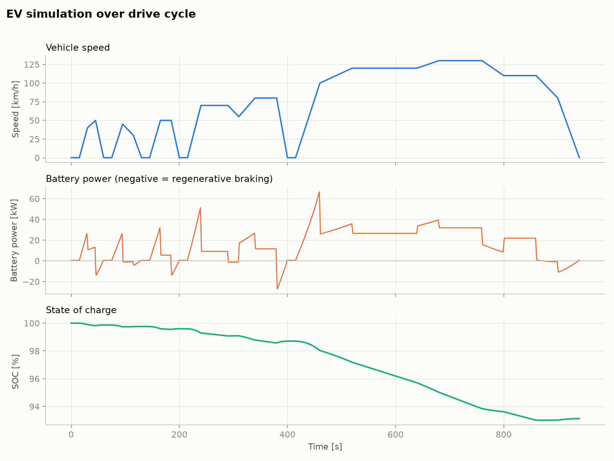
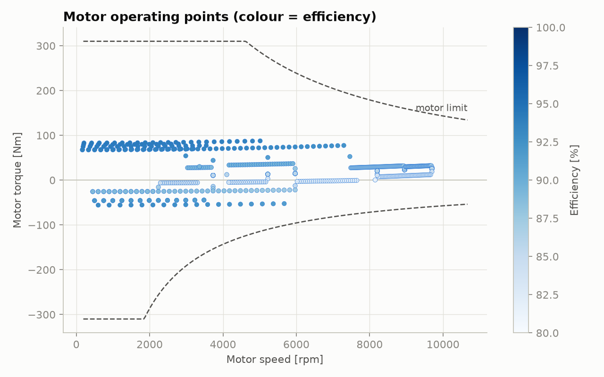
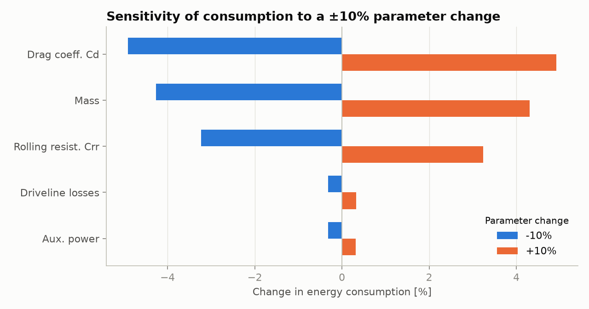

# EV Range Simulator

Developed a small, readable Python model of an electric vehicle's longitudinal dynamics and powertrain. Given a speed-vs-time drive cycle it computes battery power, state of charge (SOC), energy consumption (Wh/km) and estimated range.

## What it models

Quasi-static, backward-facing simulation at 1 s resolution:

1. **Road load**: aerodynamic drag, rolling resistance, grade and inertia (with a rotating-mass factor) give the force and power needed at the wheels.
2. **Driveline**: single-speed reduction gear with constant efficiency.
3. **Motor + inverter**: parametric efficiency as a function of torque and speed, with torque and power limits.
4. **Regenerative braking**: a configurable share of braking energy is recuperated, limited by max regen power and a minimum speed.
5. **Battery**: charge/discharge efficiency, constant auxiliary load (HVAC, electronics), SOC integration.

## Results (default vehicle, built-in cycle)

Default vehicle: 1650 kg, Cd 0.28, A = 2.2 m², Crr 0.009, 150 kW motor, 60 kWh usable battery, 500 W auxiliaries.

| Metric | Value |
|---|---|
| Cycle distance | 19.9 km (urban + suburban + highway) |
| Consumption | 177 Wh/km |
| Estimated range | 339 km |
| Regenerated energy | 0.15 kWh (4.1 % of gross) |

Sensitivity (±10 % parameter change → change in consumption): Cd ±5.9 %, mass ±3.2 %, Crr ±2.6 %, auxiliaries ±0.4 %, driveline losses ±0.3 %.





## Run it

```bash
pip install -r requirements.txt
python main.py                              # built-in cycle, default vehicle
python main.py --mass 1800 --cd 0.30 --battery 75 --aux 1500
python main.py --cycle my_cycle.csv         # CSV with columns: time_s,speed_kmh
```

Plots and the printed summary are written to `results/`.

## Project structure

```
ev_sim/vehicle.py    vehicle + powertrain parameters, motor efficiency model
ev_sim/cycles.py     drive cycles (built-in custom cycle, CSV loader)
ev_sim/simulate.py   simulation loop and sensitivity analysis
ev_sim/plots.py      matplotlib figures
main.py              command line interface
```

## Limitations

- The built-in cycle is a **custom synthetic cycle**, not the official WLTP/WLTC. Load the official cycle through `--cycle` for homologation-style numbers.
- The motor efficiency map is a simple parametric approximation, not measured data. The battery has a constant efficiency, with no temperature or SOC dependence.
- Vehicle parameters are typical values for a mid-size EV and the model has **not been validated against a real vehicle**. Treat the absolute numbers as indicative; the trends (sensitivities) are the useful part.
- No thermal model, no traction limit, flat road by default (a `grade` argument exists in `simulate()`).

## Ideas for extension

- Replace the efficiency model with a lookup table from a real motor map
- Add a battery equivalent-circuit model (voltage sag, temperature)
- Optimise the regen share, or compare gear ratios and motor sizes
- Validate against published WLTP consumption of a real car
